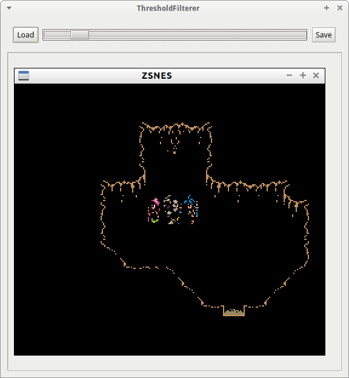

# ThresholdFilterer

Performs a threshold filter operation on an image.

ThresholdFilterer is one of [Richèl Bilderbeek's tools](https://richelbilderbeek.github.io/tools/).

## Links

- [Source code](https://github.com/richelbilderbeek/ThresholdFilterer)
- [Richèl Bilderbeek's tools](https://richelbilderbeek.github.io/tools/)
